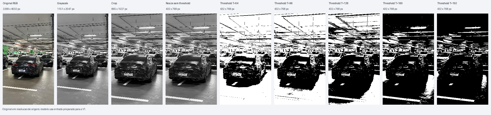

# KUIDAMOS — Front-end de pré-processamento de pixels | Grupo 6C

Projeto acadêmico de um IP digital independente para pré-processamento de imagens em streaming, desenvolvido no contexto KUIDAMOS–CIExpert. O IP recebe pixels RGB888 previamente decodificados e produz pixels de 8 bits, acompanhados de sinais de validade e marcadores de linha e quadro.

O projeto abrange especificação, modelo de referência, verificação, RTL sintetizável, síntese, DFT e implementação física conforme a infraestrutura disponível. A especificação oficial está em [docs/referencias](docs/referencias/definicao_escopo_grupo_6_oficial.pdf); as decisões da V1 estão em [docs/spec_v1.md](docs/spec_v1.md).

## Equipe

- **Wagner Cutrim Rabelo Junior — DFT**
- **Thiago Fernandes Carvalho de Souza — RTL**

A distribuição proposta de responsabilidades por marco está no [plano de execução](docs/plano_de_execucao.md) e permanece pendente de alinhamento com Thiago. O desenvolvimento contou com auxílio de ferramenta de IA (Codex), sob supervisão humana; o [registro de decisões](docs/DECISOES_E_PENDENCIAS.md) preserva a identificação das atividades e decisões documentadas.

## Arquitetura funcional

```text
RGB888 → Grayscale → Crop → Resize nearest-neighbor → Threshold → saída 8 bits
                          sinais de validade e marcadores de linha/quadro
```

- **Grayscale:** `Y = floor((77*R + 150*G + 29*B)/256)`, com canais unsigned de 8 bits.
- **Crop:** região retangular configurável, com limites superiores exclusivos e bypass.
- **Resize:** downscaling por seleção nearest-neighbor; a V1 adota fatores 1 ou 2 independentes em cada eixo. Essa restrição de escopo permanece sujeita à validação do professor.
- **Threshold:** saída 0 ou 255 conforme `pixel >= T`; o bypass preserva o valor cinza.
- **Interface V1:** streaming com `pixel_valid`, sem `ready`, e marcadores SOF, SOL, EOL e EOF regenerados para os pixels produzidos. A meta inicial é um ciclo de latência; mudanças de pipeline exigem atualização do contrato e dos testes.

O IP não inclui câmera ou sensor, decodificação de vídeo, protocolos de rede, ISP, framebuffer completo, inferência de IA ou integração obrigatória com os grupos 6A e 6B. O Golden Model usa matrizes por quadro no computador de teste; isso não implica framebuffer no IP.

## Experimento com imagem real

O Golden Model foi aplicado a uma fotografia de estacionamento, com comparação entre a saída em tons de cinza e cinco limiares. A imagem de origem foi reduzida externamente para respeitar o limite de entrada V1. O [relatório do experimento](docs/experimentos/analise_preprocessamento_imagens.md) apresenta parâmetros, imagens e resultados; essa demonstração não valida o RTL nem o desempenho de modelos de IA.



## Marcos e status

| Marco | Entrega | Status |
|---|---|---|
| M0 | Especificação | Concluído internamente; resize sujeito à validação do professor |
| M1 | Golden Model Python | Implementação inicial e testes executados |
| M2 | Vetores funcionais e temporais | Validados localmente; revisão de Thiago pendente |
| M3 | RTL pass-through e grayscale | Implementado e validado no Synopsys VCS (`X-2025.06-SP2_Full64`) |
| M4 | RTL crop | Implementado e validado no Synopsys VCS (`X-2025.06-SP2_Full64`) |
| M5 | RTL resize nearest-neighbor | Implementado e validado no Synopsys VCS (`X-2025.06-SP2_Full64`) |
| M6 | Threshold e integração | Implementado e validado no Synopsys VCS (`X-2025.06-SP2_Full64`) |
| M7 | Testbench, scoreboard, SVA e regressão | Validado no Synopsys VCS (15/15 cenários, 2.618 ciclos, 0 falhas) |
| M8 | Síntese e análise de timing | Não executado |
| M9 | DFT e scan | Não executado |
| M10 | Implementação física | Não executado |
| M11 | Documentação final | Não iniciado |

Na última regressão registrada, **32 testes Python passaram**, os **28 arquivos de referência M2 foram reproduzidos byte a byte** e a **regressão RTL M3–M7 passou integralmente no Synopsys VCS `X-2025.06-SP2_Full64` (15/15 cenários, 2.618 ciclos, 0 divergências no Scoreboard e 0 violações de SVA)**. Consulte as evidências de [M1](docs/evidencias/M1_modelo_python.md), do [teste com imagem real](docs/evidencias/M1_imagem_real.md), de [M2](docs/evidencias/M2_vetores.md) e da [verificação funcional M3–M7 no VCS](docs/evidencias/M3_M7_verificacao_vcs.md). Síntese (Design Compiler), DFT (TestMAX) e implementação física (Fusion Compiler) ainda não foram executados. A referência inicial de 100 MHz (10 ns) é uma restrição de análise, não uma garantia de fechamento de timing. PDK e bibliotecas para síntese/físico ainda precisam ser identificados.

## Estrutura atual

```text
.
├── AGENTS.md                    # instruções para ferramentas de desenvolvimento
├── docs/
│   ├── spec_v1.md              # especificação funcional e temporal
│   ├── CONTEXTO_TECNICO_6C.md  # nota técnica de apoio
│   ├── DECISOES_E_PENDENCIAS.md
│   ├── plano_de_execucao.md
│   ├── evidencias/             # resultados de M1 e M2
│   ├── experimentos/           # relatório e imagens do experimento real
│   ├── imagens/m1/             # demonstração visual sintética
│   └── referencias/            # documento oficial
├── model/                       # Golden Model, geradores e testes Python
├── rtl/                         # Módulos RTL SystemVerilog sintetizáveis (M3–M6)
├── scripts/verification/        # Script de compilação e regressão Synopsys VCS
├── tb/                          # Testbench, Scoreboard e SVA SystemVerilog (M3–M7)
├── vectors/m2/                  # referências funcionais e temporais
├── .gitattributes
└── .gitignore
```

`outputs/` é usado para arquivos gerados localmente e permanece fora do versionamento. Diretórios de RTL, testbench e fluxo EDA serão adicionados nas etapas correspondentes.

## Executar os testes Python

Os resultados documentados foram obtidos em Windows com Python 3.10.6, NumPy 2.2.6 e Pillow 10.2.0. Na raiz do projeto, crie um ambiente virtual e ative-o conforme seu sistema:

```bash
python -m venv .venv
# Linux: source .venv/bin/activate
# PowerShell: .\.venv\Scripts\Activate.ps1
python -m pip install -r model/requirements.txt
python -m unittest discover -s model/tests -v
python -X utf8 -m model.m2_vectors --output-dir vectors/m2 --check
```

O comando `--check` compara os vetores existentes sem modificá-los. Instruções para gerar vetores em outro diretório, interpretar os arquivos de texto e alinhar expectativas por ciclo estão na [evidência M2](docs/evidencias/M2_vetores.md). A [documentação do modelo](model/README.md) inclui a demonstração visual e a API Python.
