# Análise de pré-processamento de imagem real — Grupo 6C

**Experimento executado em:** 2026-11-04

**Análise dos PNGs:** 2026-11-04

**Fonte dos resultados:** Golden Model Python, imagens geradas em `outputs/real_image_threshold_sweep/` e [registro de execução](../evidencias/M1_imagem_real.md). Cópias das imagens estão em `docs/experimentos/estacionamento/`.

## Objetivo e contexto

Avaliar visual e numericamente as transformações previstas para o front-end de pixels 6C em uma fotografia de estacionamento. O experimento exercita a ordem funcional `RGB888 → grayscale → crop → resize nearest-neighbor → threshold`, bem como a saída em tons de cinza com threshold desabilitado. A imagem é um estímulo para o modelo de referência; o IP não realiza identificação de veículos ou placas.

## Entrada e configuração

O arquivo de entrada, inicialmente fornecido em `docs/assets/input/carro.jpeg`, está reproduzido em [estacionamento/carro.jpeg](estacionamento/carro.jpeg). É um JPEG RGB de **2268 × 4032** pixels, com SHA-256 `06a4bb6782f9c13060762c294cc0f731d6ad74adf3cb6bc0a42caa620a9171a4`. O responsável pelo projeto informou que a fotografia é pública; o endereço da publicação original e a autoria não foram informados. A fonte disponível para este registro é o arquivo fornecido pelo responsável.


O limite de entrada V1 é 2047 pixels por eixo. Por isso, antes da execução do modelo, a imagem completa foi reduzida proporcionalmente para **1151 × 2047** com Pillow/Lanczos. Essa preparação é externa ao Golden Model e ao IP; não é a operação de resize nearest-neighbor avaliada no pipeline.

| Etapa | Parâmetros e dimensões efetivamente utilizados | Arquivo |
|---|---|---|
| Original RGB | 2268 × 4032 | [00_original_rgb.png](estacionamento/00_original_rgb.png) |
| Entrada preparada | RGB888, 1151 × 2047 | [01_original_rgb.png](estacionamento/01_original_rgb.png) |
| Grayscale | `floor((77R + 150G + 29B)/256)`, 1151 × 2047 | [02_grayscale.png](estacionamento/02_grayscale.png) |
| Crop | Origem `(143,255)` na entrada preparada; largura 865 e altura 1537; limites superiores exclusivos | [03_crop.png](estacionamento/03_crop.png) |
| Resize | Nearest-neighbor, fator 2 em X e Y; saída com piso, 432 × 768 | [04_resize_nearest.png](estacionamento/04_resize_nearest.png) |
| Threshold | Habilitado, `T ∈ {64,96,128,160,192}`; cada saída tem 432 × 768 | PNGs individuais na tabela seguinte |

A montagem comparativa apresenta as etapas e os cinco limiares lado a lado. Ela usa imagens reduzidas para visualização; as contagens abaixo foram calculadas a partir dos PNGs individuais, sem usar a montagem.

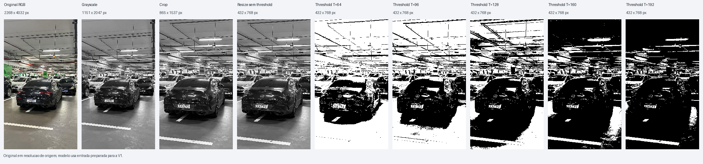

## Resultados por operação

- **Grayscale:** a saída conservou a estrutura visual da cena em 1151 × 2047, transformando cada pixel RGB em uma intensidade de 8 bits. A representação não conserva as três componentes de cor separadamente.
- **Crop:** a ROI selecionada contém **1.329.505 pixels**, de um total de **2.356.097** na imagem preparada. A área selecionada representa 56,43% dos pixels de entrada; os 43,57% restantes ficam fora da ROI. A montagem mostra a região central com os veículos, enquanto parte da cena periférica é removida. A utilidade da ROI depende de sua posição e do conteúdo de cada imagem.
- **Resize:** a saída contém **331.776 pixels**, equivalentes a 24,95% dos pixels da ROI; os demais não são emitidos. A seleção nearest-neighbor preserva os valores de cinza nas posições selecionadas, sem interpolação no modelo, mas detalhes presentes apenas nas posições descartadas deixam de aparecer. As dimensões ímpares da ROI são tratadas pela regra de piso da V1.
- **Threshold:** para cada limiar, a intensidade após resize é convertida em 255 quando é maior ou igual a `T`, e em 0 caso contrário. O resultado é uma imagem binária em barramento de 8 bits. A saída sem threshold preserva as intensidades de cinza dos pixels selecionados.

### Imagens das etapas

Entrada RGB preparada para o modelo:

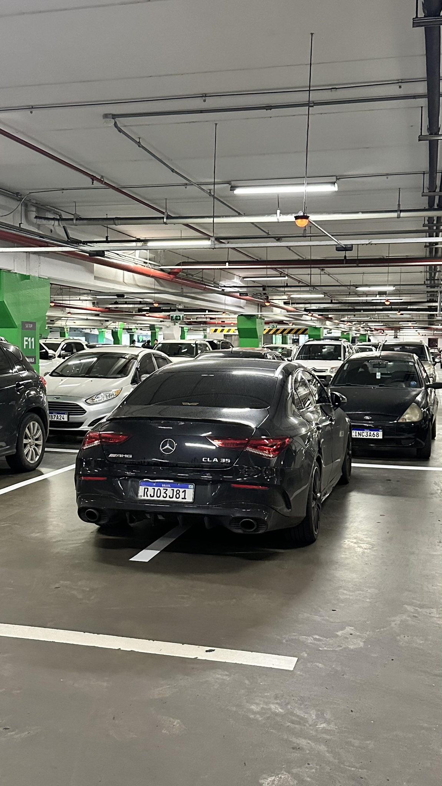

Grayscale:

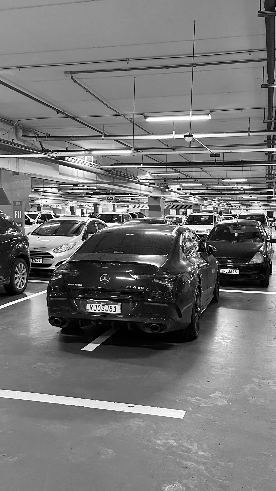

Crop:

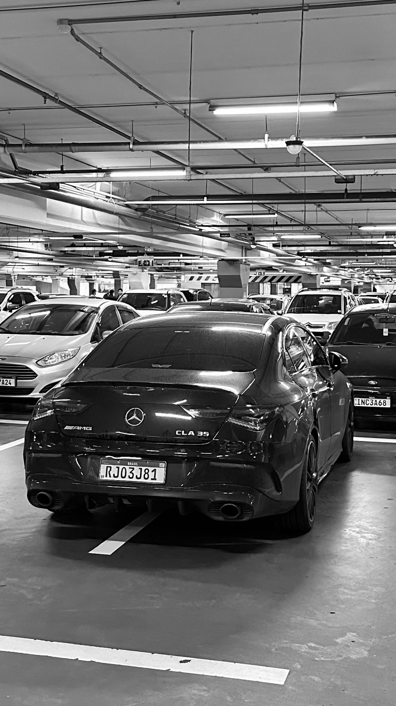

Resize nearest-neighbor, sem threshold:

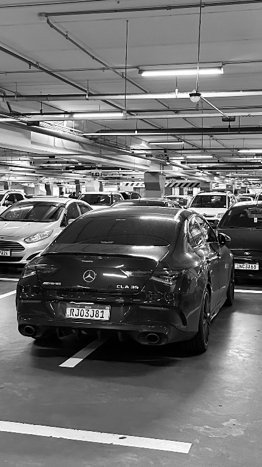

## Comparação dos limiares

Cada percentual foi calculado diretamente do respectivo PNG de saída, usando **331.776 pixels** como denominador. Os cinco arquivos foram reabertos e verificados como imagens `L` de 432 × 768 contendo somente valores 0 e 255. Os pixels também foram comparados à aplicação de `pixel >= T` sobre o PNG após resize.

| Limiar | Saída | Pixels brancos | Brancos (%) | Pixels pretos | Pretos (%) |
|---:|---|---:|---:|---:|---:|
| 64 | [threshold_64.png](estacionamento/threshold_64.png) | 237.223 | 71,50% | 94.553 | 28,50% |
| 96 | [threshold_96.png](estacionamento/threshold_96.png) | 207.331 | 62,49% | 124.445 | 37,51% |
| 128 | [threshold_128.png](estacionamento/threshold_128.png) | 144.611 | 43,59% | 187.165 | 56,41% |
| 160 | [threshold_160.png](estacionamento/threshold_160.png) | 60.906 | 18,36% | 270.870 | 81,64% |
| 192 | [threshold_192.png](estacionamento/threshold_192.png) | 38.289 | 11,54% | 293.487 | 88,46% |

À medida que o limiar aumenta, menos pixels atendem à condição `pixel >= T`; por isso a proporção branca diminui nesta comparação. Na montagem, limiares mais baixos mantêm áreas claras mais extensas, enquanto limiares mais altos deixam uma parcela maior da cena preta. A tabela caracteriza esta imagem e esta ROI; não determina um limiar universalmente melhor.

T = 64:

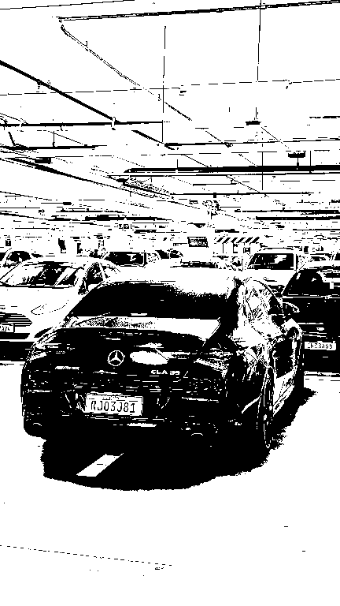

T = 96:

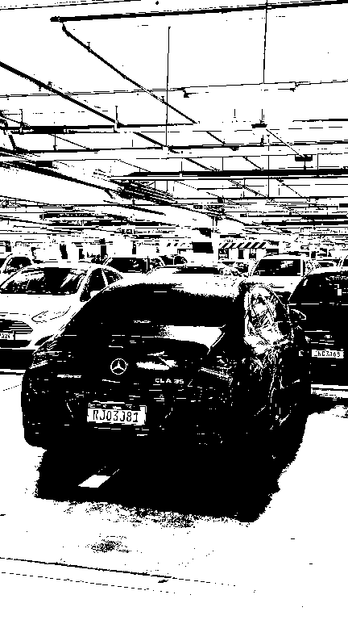

T = 128:


T = 160:

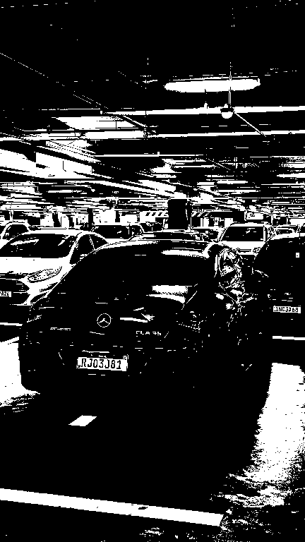

T = 192:

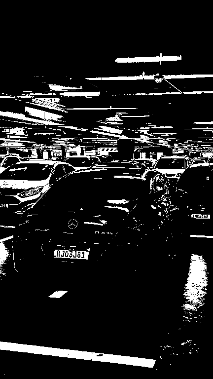

### Arquivos complementares

O fluxo também produziu uma cópia PNG em RGB da fotografia original:


A primeira execução registrou a etapa `T=128` como `05_threshold.png`; a análise com múltiplos limiares mantém também `threshold_128.png`.

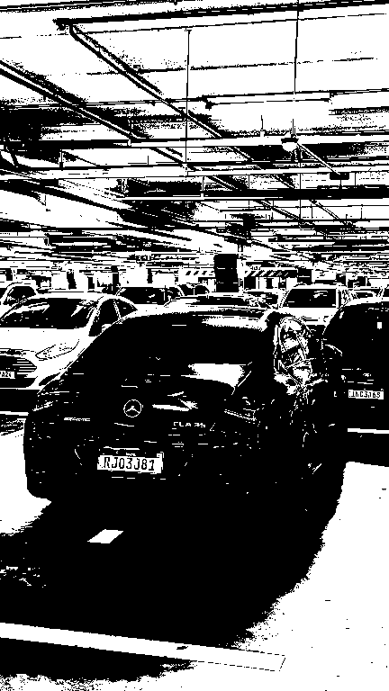

Comparativo das cinco etapas da execução inicial:

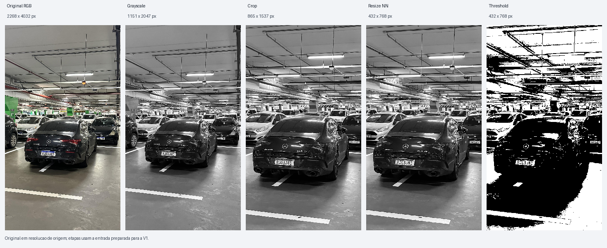

## Perda de informação e bypasses

Grayscale combina os três canais e não permite recuperar a cor original a partir do resultado. O crop elimina tudo fora da ROI; seu bypass permite processar o quadro completo quando não há uma região de interesse conhecida. O resize por descarte reduz amostras espaciais e pode remover linhas finas ou texturas, mesmo quando a imagem reduzida permanece visualmente reconhecível. A seleção de fator 1 em ambos os eixos mantém a geometria espacial da entrada do estágio.

O threshold reduz os níveis de cinza a duas classes e pode fazer regiões distintas assumirem o mesmo valor. O bypass de threshold preserva os níveis de intensidade que restaram após crop e resize; não recupera a cor nem os pixels já descartados. A escolha de bypass e parâmetros deve considerar a finalidade do sistema que receberá a saída.

## Reprodução e disponibilidade

Dependências e versões utilizadas estão em [model/README.md](../../model/README.md). Com a imagem de entrada disponível localmente, execute a partir da raiz, escolhendo um diretório de saída novo:

```bash
python -X utf8 -m model.threshold_sweep --input docs/experimentos/estacionamento/carro.jpeg --output-dir outputs/real_image_threshold_sweep_novo
```

O script recusa sobrescrever resultados existentes. `outputs/` permanece fora do versionamento; as cópias da fotografia pública fornecida e dos PNGs utilizados estão em `estacionamento/` para acompanhar este relatório. As cópias foram verificadas por comparação SHA-256 com os arquivos locais do experimento.

Para recalcular as contagens **dos arquivos gerados**, execute na raiz:

```python
from pathlib import Path
from PIL import Image

directory = Path("docs/experimentos/estacionamento")
for threshold in (64, 96, 128, 160, 192):
    with Image.open(directory / f"threshold_{threshold}.png") as image:
        assert image.mode == "L"
        histogram = image.histogram()
        assert sum(histogram[1:255]) == 0
        total = image.width * image.height
        print(threshold, histogram[255], 100 * histogram[255] / total,
              histogram[0], 100 * histogram[0] / total)
```

## Limitações e próximos experimentos

Esta análise compreende uma única imagem e configurações escolhidas para demonstração. A preparação externa Lanczos altera a imagem antes do processamento e não é implementada pelo IP. A inspeção visual e os percentuais de pixels não medem desempenho ou acurácia de modelos de IA, não comprovam benefícios para reconhecimento de placas e não validam RTL, temporização, síntese ou DFT. Nenhuma ferramenta Synopsys foi executada para este experimento.

Experimentos futuros podem comparar outras imagens e iluminações, ROIs e limiares, testar os bypasses com a mesma entrada, avaliar dimensões ímpares e padrões sintéticos com detalhes finos e, quando o RTL existir, confrontar valores, quantidades e marcadores contra o Golden Model. Qualquer avaliação de modelo de IA requer um conjunto de dados, métricas e procedimento próprios.

O experimento confirma, para os arquivos examinados, a correspondência entre os cinco PNGs binários e a regra de threshold aplicada à saída após resize. Ele evidencia os compromissos entre redução de dados e preservação de informação, dentro dos limites da configuração utilizada.
