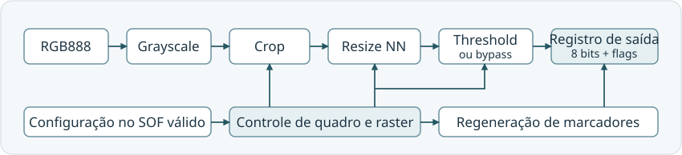
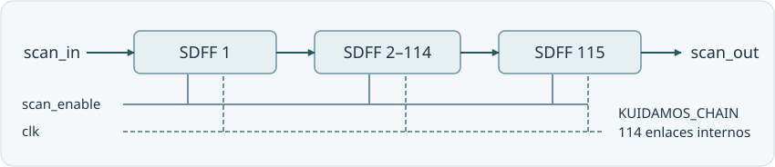

# KUIDAMOS 6C — relatório técnico do front-end de pixels

**Versão de entrega acadêmica · 27/11/2026**

Wagner Cutrim Rabelo Junior — DFT · Thiago Fernandes Carvalho de Souza — RTL e síntese

O baseline de M0–M10 é o merge `3fb7875` da `main`. Esta versão
consolida as evidências desse baseline e o experimento complementar
do M11. [Escopo oficial do Grupo 6C](../referencias/definicao_escopo_grupo_6_oficial.pdf) · [Matriz de rastreabilidade](matriz_rastreabilidade.md)

## 1. Introdução e objetivos

O projeto KUIDAMOS–CIExpert avalia o desenvolvimento de IPs digitais
em um fluxo acadêmico de EDA. O Grupo 6C entrega um front-end que
recebe pixels RGB já decodificados e produz um fluxo de luminância
ou pixels binários. A transformação é adequada ao processamento em
raster, com controle explícito de quadros, linhas e validade.

O objetivo foi especificar, implementar e verificar o IP, sintetizá-lo,
inserir e validar scan e executar a implementação física até routing
com os recursos do CIExpert. O ponto de análise temporal adotado foi
100 MHz. Aquisição de vídeo, decodificação e inferência pertencem a
outros componentes do sistema. [Contexto do Grupo 6C](../CONTEXTO_TECNICO_6C.md)

## 2. Especificação do IP

A interface síncrona aceita um pixel RGB888 por borda válida de
`clk`. Bolhas congelam as coordenadas. A fonte fornece o quadro em
ordem raster e o destino aceita toda saída válida. O reset é
síncrono e ativo baixo. Um pixel selecionado na borda `n` aparece
registrado após essa borda e pode ser consumido em `n+1`. Assim,
a transferência borda a borda tem latência de um ciclo.

| Grupo de sinais | Contrato V1 |
|---|---|
| Entrada de dados e sincronismo | Três canais de 8 bits, `pixel_valid`, SOF, SOL, EOL e EOF |
| Configuração | Capturada no SOF válido. Dimensões de 1 a 2.047 por eixo, ROI, fatores de resize, habilitação e limiar de 8 bits |
| Saída | Pixel de 8 bits, `pixel_out_valid`, quatro marcadores regenerados e `cfg_error` |
| Configuração inválida | Pulso `cfg_error` e descarte do quadro. Um novo SOF válido permite recuperação |

O grayscale usa `floor((77R+150G+29B)/256)`. O crop mantém
coordenadas dentro da ROI com limites superiores exclusivos.
O resize aplica o mapeamento nearest-neighbor após o crop. A V1
deriva as dimensões por piso e aceita fatores 1 e 2 independentes
em X e Y. O threshold habilitado emite 255 quando `Y >= T` e
zero abaixo do limiar. Em bypass, preserva a luminância. O recorte
de resize foi aprovado internamente e aguarda confirmação do
professor. [Contrato completo da V1](../spec_v1.md)

## 3. Arquitetura e microarquitetura

*Figura 1 — Arquitetura lógica da V1.*

Os núcleos de transformação são combinacionais. Os registradores
armazenam estado de quadro, contadores, parâmetros de configuração e
saída. A soma de luminância usa 16 bits, com máximo de 65.280 antes do
deslocamento. Coordenadas e dimensões usam 11 bits, enquanto limites
e comparações ampliados usam 12 bits. O resize de fator dois verifica
paridade e o limite de amostras exigido pelo piso. Os marcadores
decorrem das coordenadas de saída, inclusive quando o primeiro ou
último pixel da entrada é descartado. O datapath opera em streaming
sem armazenar linhas ou quadros. [Arquitetura no repositório](../../rtl/README.md)

## 4. Modelo de referência

O Golden Model usa Python/NumPy para calcular cada estágio de forma
independente do RTL. O nearest-neighbor usa os índices da equação
geral do PDF, calculados sobre a ROI. O gerador temporal M2 usa o
resultado por quadro para associar valores e flags aos ciclos, com
reset, descarte, bolhas e consumo no ciclo seguinte. Foram registrados
32 testes Python aprovados após o experimento M1 e 28 arquivos M2
conferidos byte a byte.

*Figura 2 — Saída do exemplo sintético já documentado no M1. A
montagem com fotografia e saída capturada do RTL tem rastreabilidade
própria no capítulo 6.*
[Modelo e figuras M1](../evidencias/M1_modelo_python.md) · [Vetores M2](../evidencias/M2_vetores.md)

## 5. Implementação RTL

| Módulo SystemVerilog | Implementação |
|---|---|
| `grayscale_core` | Soma ponderada RGB e redução para 8 bits |
| `crop_core` | Comparadores de ROI e coordenadas relativas |
| `resize_nn_core` | Seleção de amostras nos eixos e coordenadas da saída |
| `threshold_core` | Comparador sem sinal, saída binária e bypass |
| `kuidamos_pixel_frontend` | Captura e validação da configuração, controle de reset e quadro e registro de pixel, validade, flags e erro |

A captura no SOF permite alterações externas na configuração durante
o restante do quadro sem afetar seus pixels. O topo usa `in_sof`
e as dimensões capturadas para delimitar a progressão raster.
`in_sol` e `in_eol` permanecem na interface sem cargas internas.
A saída preserva a ordem dos pixels selecionados e o protocolo
define a recuperação no próximo SOF válido.
[RTL e arquivos de compilação](../../rtl/README.md) · [Temporização da interface](../spec_v1.md#5-contrato-temporal-e-recuperação)

## 6. Verificação funcional

A regressão oficial no VCS executou nove casos produzidos pelo
gerador M2 e seis casos dirigidos M7, com **15/15 aprovados em
2.618 ciclos**. O scoreboard comparou valores, quantidade,
ordem, marcadores e sinais inválidos. O monitor executou oito
propriedades concorrentes e verificações procedurais. Foram registradas
2.617 checagens pós-borda e zero divergências ou erros SVA.
Os testes negativos de scoreboard e assertion também foram
exercitados no M7. [Relatório VCS M3–M7](../evidencias/M3_M7_verificacao_vcs.md)

Com o VCS X-2025.06-SP2_Full64, uma fotografia já usada pelo modelo foi
preparada externamente para **144 × 256** pixels. O fluxo usou
grayscale, ROI de 107 × 191 em (18, 32), resize (2, 2) e threshold
128. O RTL e a netlist `physical_final` emitiram **5.035 pixels**
em um quadro de **53 × 95**, sem divergências de valor, ordem ou
marcador em 36.872 ciclos por execução. O monitor RTL registrou
36.871 checagens pós-borda sem erro. A netlist foi exercitada no
modo funcional com o scoreboard. A validação temporal com SDF
continua pendente.

A reconstrução usou os pixels efetivamente amostrados do DUT.
O comparativo tem quatro painéis com RGB de entrada, referência,
resultado do DUT e diferenças. O mapa ficou integralmente preto,
indicando zero diferenças, e o PNG reconstruído foi idêntico
ao esperado. A montagem fotográfica permanece no handoff local.
[Evidência, hashes e reprodução M11](../evidencias/M11_imagem_real_vcs.md)

Wagner selecionou como **demonstração principal** a entrada de
**576 × 1024**, crop de **376 × 264** com origem **(88, 456)**,
grayscale, resize **(1,1)** e threshold em **bypass**. A saída
preserva a resolução da ROI e os contornos mais nítidos nesta foto.
A comparação com (2,2) produz **188 × 132**, um quarto das
amostras. A V1 mantém os fatores 1 e 2 por eixo. A varredura
incluiu T=64, 96, 128, 160 e 192. T=96 em (1,1) foi o destaque binário.

O VCS aprovou **6/6 configurações RTL** e comparou **937.248
pixels**, sem divergências de valor, ordem ou marcadores e sem
erros SVA. Em cada caso houve 589.829 ciclos e 589.828 checagens
pós-borda. A varredura completa dos limiares veio do Golden Model.
Os painéis marcados como RTL foram reconstruídos de pixels
capturados do DUT. O zoom inteiro dos detalhes replica amostras.
A demonstração avalia pré-processamento. Reconhecimento de
caracteres está fora do escopo. [Evidência de detalhe e casos VCS](../evidencias/M11_imagem_real_detalhe.md)

## 7. Síntese lógica

O Design Compiler X-2025.06-SP2 mapeou o RTL para SAED32 RVT no
corner `ss0p95v125c`, a 0,95 V e 125 °C, com SDC de 10 ns.
O resultado teve 1.256 células folha, incluindo 115 flip-flops e
zero latches. Foram exportados netlist e SDC para o DFT, além de
DDC, SDF e outros relatórios. O setup de +3,21 ns e o hold de
+0,16 ns usam o modelo de carga de fios da síntese.
[Relatório M8](../evidencias/M8_sintese_dc.md)

## 8. DFT e scan insertion

O fluxo importou a netlist e o SDC de M8 no Fusion Compiler
X-2025.06-SP2. O fluxo executou pré-DFT DRC, precheck, replacement,
preview e inserção com o motor de DRC TestMAX integrado. O caminho funcional foi preservado
e o protocolo de teste define `clk` a 100 ns, com bordas em 45 ns
e 55 ns e reset síncrono inativo.

*Figura 7 — Encadeamento lógico de scan e controles compartilhados.*

O M9 conectou 114 enlaces internos, sem compressão e sem exclusões.
O DFT DRC indicou zero violações no resumo e 91 avisos detalhados.
Os avisos foram B7 (44), B8 (2), B10 (44) e N20 (1). O N20 indica
comportamento subespecificado no UDP de Q da SDFFX1 quando SE=X
na subida de clock. O efeito em ATPG segue em aberto. O VCS aprovou
**15/15 cenários funcionais** e conferiu **460 pulsos de shift**. O M10 preservou a ordem e os enlaces, mesmo
após dez células passarem à variante X2. [Resultado e avisos M9](../evidencias/M9_resultado_final.md) · [Revalidação M10](../evidencias/M10_resultado_final.md)

## 9. Implementação física

| Etapa | Resultado observado |
|---|---|
| Floorplan | 52 rows `unit` e utilização nominal inicial próxima de 50% |
| Power planning e placement | Anéis M7/M8, malha M5/M6 e rails M1. A correção M1 de 0,152 para 0,060 µm removeu violações de espaçamento com células colocadas |
| Pinos e CTS | 126 portas em M3/M4. Cinco buffers alcançaram os 115 sinks nas seis redes de clock |
| Routing e ECO | Clock físico, roteamento de sinais, extração Cmin/Cmax, proteção da cadeia e fechamento dos DRVs |
| Readback | `physical_final` salvo e reaberto. Netlist, geometria, PG e cadeia conferiram. VCS 15/15 e shift 460 foram reexecutados na netlist final |

Foram legalizadas **1.276 células**, com **1.486 redes necessárias
roteadas**. As duas entradas sem carga ficaram sem rota. Os checks
registraram zero opens, shorts, DRC interno, PG DRC, pinos PG
desconectados e violações de transição ou capacitância. Os exports
locais incluem DEF, Scan DEF, netlist, SPEF, SDF, SAIF e SVGs.
O PDF local mostra o floorplan, o placement aceito após a correção
dos rails, os objetos de CTS e a geometria exportada após routing.
As linhas do CTS representam ligações lógicas entre objetos da
árvore. A figura de routing deriva dos segmentos registrados no DEF.
[Floorplan](../evidencias/M10_floorplan_inicial.md) · [Correção do PG](../evidencias/M10_correcao_pg_placement.md) · [Resultado final M10](../evidencias/M10_resultado_final.md)

## 10. Resultados de área, timing e potência

A comparação usa a **área de células**, sem a área de interconexão
estimada pelo DC. No M10, o core de 86,488 × 86,944 µm tem
**7.519,612672 µm²**, e o die de 99,864 × 100,320 µm tem
**10.018,356480 µm²**. A área de células divide-se pela área do core
para obter a utilização de **51,59%**.

| Marco | Células | Área de células (µm²) | Contexto |
|---|---:|---:|---|
| M8 | 1.256 | 3.523,4524 | Síntese lógica SAED32 RVT |
| M9 | 1.256 | 3.757,2649 | Pós-scan, área lógica |
| M10 | 1.276 | 3.878,9998 | Implementação física após ECO |

| STA do M10 | Pior setup (ns) | Pior hold (ns) |
|---|---:|---:|
| Funcional slow | +1,8647 | +0,1861 |
| Funcional fast | +5,3614 | +0,0639 |
| Shift slow | +99,6606 | +0,2119 |
| Shift fast | +99,8550 | +0,0827 |
| Captura estática slow | +94,4061 | +0,2761 |
| Captura estática fast | +97,7190 | +0,1136 |

O TNS foi zero nos caminhos cobertos. O clock propagado usou
10 ns no funcional e 100 ns nos modos de teste. No físico,
o skew global foi de 10,9 ps em fast e 20,6 ps em slow. A
referência de 100 MHz tem suporte nos relatórios desse cenário e
nas condições de análise registradas.

| Estimativa de potência M10 | µW |
|---|---:|
| Interna | 138,3041 |
| Switching | 30,3132 |
| Dinâmica total | 168,6173 |
| Leakage | 189,7378 |
| Total | **358,3551** |

A potência pós-route corresponde a SAED32 RVT slow, 0,95 V,
125 °C e 100 MHz, usando RC extraído e SAIF dos 15 cenários
funcionais do VCS. A atividade simulada alcançou **99,40% dos
drivers** (1.479 de 1.488). M8 registrou 267,27 µW com atividade propagada pelo
DC e carga de fios estimada. Atividade, modelo de interconexão
e netlist variam entre os dois ensaios. A diferença entre os totais
não isola o efeito da implementação física.
[Estimativa de M8](../evidencias/M8_sintese_dc.md) · [RC, STA e potência de M10](../evidencias/M10_resultado_final.md)

## 11. Manual de reprodução

O [manual consolidado](manual_reproducao.md) lista dependências,
versões, comandos e critérios de M1 a M10, os dois ensaios de
imagem do M11 e a montagem do PDF a partir dos artefatos existentes. Em uma instalação com acesso ao CIExpert, a sequência de
checkpoint parte do `scan_inserted`, passa pelo floorplan, PG,
placement, CTS e routing e chega ao `physical_final`. Cada estágio
usa sua própria pasta de trabalho. Os diretórios e manifests dos
handoffs permitem relacionar relatórios, netlists e exports
à versão usada no ensaio. A reprodução completa depende das
licenças e referências tecnológicas disponíveis à pessoa revisora.

## 12. Limitações e trabalhos futuros

- **Resize V1.** Os fatores 1 e 2 por eixo estão implementados e
  verificados. O aceite do recorte em relação à interface conceitual
  do PDF aguarda manifestação do professor.
- **MMMC de teste.** Os cenários cobrem caminhos restringidos.
  Faltam parâmetros externos de I/O de teste e especificação de
  captura at-speed. A captura estática registrada não cobre esse caso.
- **SDF, DFT e equivalência.** O VCS ignorou 15 interconexões na
  anotação diagnóstica. Regressão temporal completa, ATPG,
  cobertura de falhas e equivalência formal permanecem pendentes.
- **Qualificação física.** Taps, endcaps, fillers, ties, antena,
  latch-up e IR/EM exigem dados e regras adicionais. DRC/LVS e
  correlação independente da extração e do STA também permanecem
  pendentes. Os checks deste relatório são os internos do FC.
- **Demonstração visual.** Os dois ensaios usam a mesma fotografia.
  O primeiro cobre RTL e gate-level funcional. O segundo compara
  seis configurações RTL. O contexto visual e a escolha de limiar
  são específicos da cena. Wagner autorizou a publicação deste PDF.
  A licença da fotografia permanece sem identificação.

## 13. Conclusão

O Grupo 6C implementou e verificou um front-end de pixels em
streaming com processamento bit-exato nos casos exercitados.
As evidências incluem síntese a 100 MHz, uma cadeia de 115 SDFFs
validada e implementação física com routing, extração e potência
estimada. Os casos complementares conferiram o ensaio inicial no
RTL e na netlist, e as seis configurações RTL da demonstração
de detalhe. A escolha do crop em grayscale preservou melhor as
informações visuais na região examinada.

O M10 está consolidado no escopo acadêmico. O pacote M11 reúne
o relatório, o manual, a matriz e as evidências. Em 27/11/2026,
Wagner confirmou que Thiago revisou o projeto e deu retorno
positivo. A confirmação do professor sobre o recorte de
resize da V1 permanece pendente.

## Referências

1. CIExpert. [Definição oficial do escopo do Grupo 6](../referencias/definicao_escopo_grupo_6_oficial.pdf), seção 6, Grupo 6C, pp. 11–20.
2. Grupo 6C. [Especificação V1](../spec_v1.md) e [modelo de referência](../../model/README.md).
3. Grupo 6C. [Regressão VCS de M3–M7](../evidencias/M3_M7_verificacao_vcs.md) e [síntese Design Compiler](../evidencias/M8_sintese_dc.md).
4. Grupo 6C. [Resultado DFT M9](../evidencias/M9_resultado_final.md) e [implementação física M10](../evidencias/M10_resultado_final.md).
5. Grupo 6C. [Ensaio de imagem RTL e gate-level](../evidencias/M11_imagem_real_vcs.md) e [demonstração em maior resolução](../evidencias/M11_imagem_real_detalhe.md).
6. Grupo 6C. [Manual de reprodução](manual_reproducao.md) e [matriz de rastreabilidade](matriz_rastreabilidade.md).
